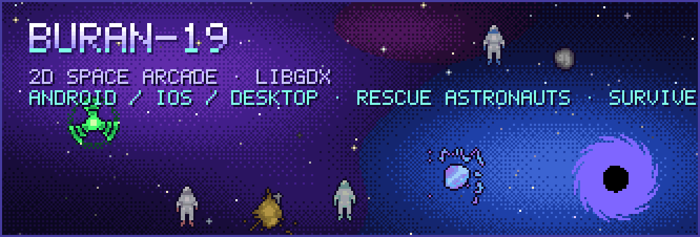

<p align="center">
  
</p>

<p align="center">
  
  
  
  
</p>

**Buran-19** is an indie 2D space arcade. You fly the Buran shuttle through open space, rescue stranded astronauts
and try to stay alive as long as the fuel lasts.


## Gameplay

- **Rescue astronauts.** Fly close and the tractor beam pulls them aboard. Medics, mechanics, scientists and military crew each bring their own bonus.
- **Collect supplies.** Crates, fuel boxes and storages refill fuel, shields and weapons.
- **Survive.** Metal and mineral asteroids, homing rockets, black holes and four kinds of anomalies (corrosive, electrical, magnetic, radiation) are all out to get you.
- **Fight back.** Lasers, rockets, shields, freeze, scan and radar, with killing sprees for chain kills.
- **Profiles and results.** Several player profiles, difficulty levels, detailed score history.

## Screenshots

<p align="center">
  
  
  
  
</p>
<p align="center">
  
  
  
  
</p>

## Build and run

The project is a standard libGDX Gradle setup from 2018–2021: Gradle 4.6 wrapper and Android Gradle plugin 3.1, so use **JDK 8**.

```bash
git clone https://github.com/soloyes/buran-19.git
cd buran-19
./gradlew desktop:run           # desktop version
./gradlew android:installDebug  # Android device or emulator (needs Android SDK)
./gradlew ios:launchIPhoneSimulator  # iOS via RoboVM (macOS + Xcode)
```

## Project layout

| Module | Contents |
|---|---|
| `core` | All game logic: shuttle, bots (asteroids, rockets, anomalies, black hole, consumables), effects, UI, screens |
| `android` | Android launcher; shared assets live in `android/assets` (sprites, sounds, music, shaders) |
| `desktop` | LWJGL desktop launcher |
| `ios` | RoboVM iOS launcher |
| `tools` | Texture packer and skin composer projects, source images, store graphics |

## Authors

Made by [Vitaly Solovev](https://github.com/soloyes), with contributions from FlameXander, Pavel Guryanov and htfdream.

History moved from [Bitbucket](https://bitbucket.org/soloyes/buran-19) with all 595 commits and branches.
