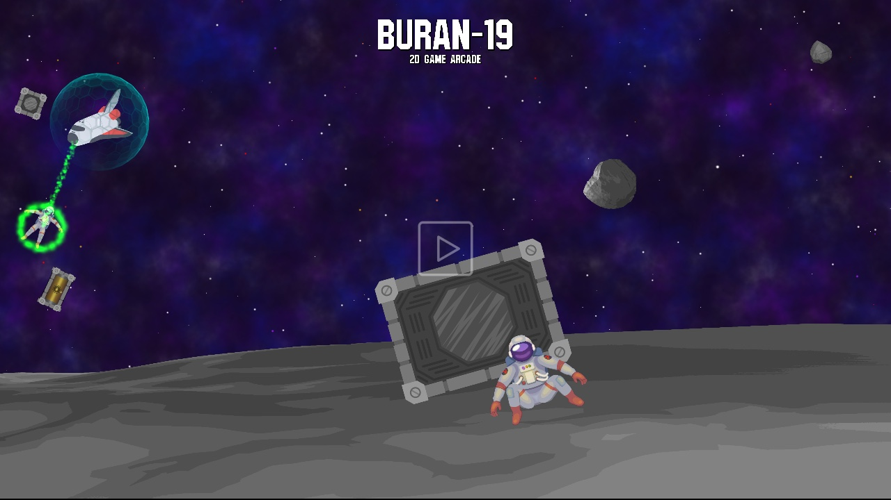
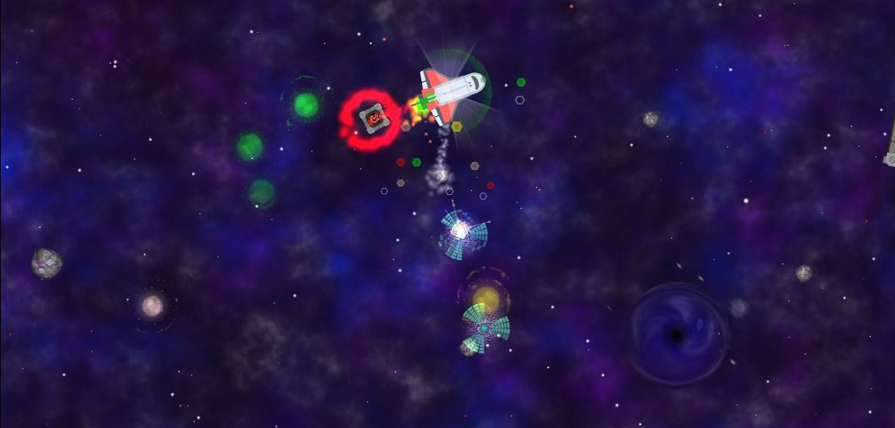

<p align="center">
  <a href="https://soloyes.github.io/OpenShuttle/"></a>
</p>

<p align="center">
  <b><a href="https://soloyes.github.io/OpenShuttle/">Play in the browser</a></b> &middot; Xbox (Edge), PC, phone
</p>

<p align="center">
  
</p>

<p align="center">
  
  
  
</p>

Buran-19 is an indie 2D space game about loneliness and hope. 1991: the Buran program never ended, it went
quiet. Flight to Object-19 failed, the station broke apart, its crew drifted into the field and a rift opened
in the middle of it. Mission control stopped answering. You fly the Buran, bring your people home and find out
where home still is.



## Gameplay

**Campaign.** Three chapters, nineteen sectors. Each sector teaches one thing, states the goal and leaves the
method to you: rescue the crew, salvage the rocks, recover the cargo, then reach the extraction beacon.
Every sector opens with a voiced radio briefing; every chapter ends with a short comic scene.
Each sector keeps your best time and three medals: no crew lost, hull untouched, inside the par time.

| Chapter | Sectors | What it teaches |
|---|---|---|
| One - Silence | 01-06 | Flying and the tractor beam, the laser and salvage, electric anomalies and the EMP, the rift and shelters, sealed cargo, all of it together |
| Two - The Voice | 07-12 | Radiation and rockets, magnetic anomalies and fuel, packs and freeze, the ram shield, discharge storms, a collapsing field |
| Three - Home | 13-19 | Everything again, harder: the graveyard, guarded cargo, the tide of the rift, a sector without radar, the threshold and the way home |

**Arcade.** The endless run: nineteen steps to the collapse, with the same voice on the radio as the field
grows stronger.

**The ship.** The tractor beam takes crew and cargo aboard. Each crew member brings a bonus (medic, mechanic,
scientist, military, commander). The laser burns rocks into fragments: mineral recharges the laser, metal
charges the **ram shield**. Switched on, the ram shield breaks anomalies below its level and softens rock
hits, but crew can only come aboard over the wings. The **EMP** burns electric anomalies and throws the rest
back, paid for with the shield. **Shelters** hide you from hunters and mend the shield. The **rift** pulls in
everything that crosses its ring.

## Screenshots

<p align="center">
  
  
  
  
</p>
<p align="center">
  
  
  
  
</p>

## Play on Xbox

The game runs in the browser, so on Xbox it is played in Microsoft Edge. No Dev Mode needed.

1. Open the game URL in Edge on the console (GitHub Pages: `https://soloyes.github.io/OpenShuttle/`).
2. Press **A** on the start screen. This switches to fullscreen and unlocks sound.
3. Play with the controller:

| Control | In flight | In menus |
|---|---|---|
| Left or right stick | Fly where the stick points (deflection = thrust) | Move / scroll |
| Both sticks | Left: throttle and brake, right: turn | |
| A | Ram shield on / off | Select |
| X / RT | Use the selected item | |
| LB / RB, D-pad | Previous / next item | Navigate |
| Y | EMP pulse (costs shield) | |
| B, Menu | Pause | Back |

Keyboard: arrows / WASD fly, Space ram shield, X use item, Q / E switch items, F EMP, Esc pause.

**Debug URL flags** (append to the game URL): `unlock` opens every sector, `debug=clear` completes the goal
at once, `third` starts a third of the way in, `ram` starts with a charged ram shield, `card` shows the crew
card, `chapter`, `chapter=2`, `chapter=3` play a chapter ending instead of the intro.

## Build and run

Requires JDK 17 or newer. The Gradle wrapper (Gradle 9) downloads everything else.

```bash
./gradlew desktop:run                       # desktop (LWJGL3)
./gradlew web:gdx_teavm_web_js_run          # web dev build, http://localhost:8080
./gradlew web:gdx_teavm_web_js_release_run  # optimized web build, http://localhost:8180
./gradlew web:gdx_teavm_web_js_release_build  # output: web/build/dist/js/release/webapp
./gradlew desktop:generateFonts             # re-bake assets/fonts/*.fnt from the TTF
```

Every push to `main` builds the web version and deploys it to GitHub Pages (`.github/workflows/web.yml`).
Pages must be enabled once in the repository settings: Settings, Pages, Source: GitHub Actions.

## How the web port works

- Java is compiled to JavaScript with [gdx-teavm](https://github.com/xpenatan/gdx-teavm) (TeaVM).
- Fonts are pre-rendered bitmap fonts instead of FreeType at runtime (`desktop/fontgen`).
- Profiles and settings are stored with libGDX `Preferences`: `localStorage` in the browser, `~/.prefs/buran19` on desktop.
- Gamepad support is in `core/src/com/buran/game/input/Gamepad.java` (gdx-controllers, browser Gamepad API).
- `web/webapp/index.html` is the entry page: Xbox start screen, fullscreen, audio unlock, and it keeps the B button
  (browser Back on Xbox) from leaving the game.
- Ads and Google Play links are switched off.

## Project layout

| Module | Contents |
|---|---|
| `core` | All game logic: the Buran, bots (asteroids, rockets, anomalies, black hole, consumables), effects, UI, screens, gamepad input |
| `assets` | Sprites, sounds, music, shaders, pre-rendered fonts |
| `web` | TeaVM web launcher and the Xbox-friendly entry page |
| `desktop` | LWJGL3 desktop launcher and the font baking tool |
| `tools` | Art preparation (`art/`, `intro/`), voice (`vo/`: Chatterbox TTS and the radio chain), synthesised music (`music/`) and sounds (`sfx/`), texture packer projects, store graphics |
| `art` | Source art for the intro, the chapter endings and the UI (prompts in `docs/art/ui-prompts.md`) |

The original Android and iOS launchers were removed in the web port; they are in the git history.
The previous contents of this repository are kept under the tag `legacy/openshuttle`.

## Authors

Made by [Vitaly Solovev](https://github.com/soloyes), with contributions from FlameXander, Pavel Guryanov and htfdream.

History moved from [Bitbucket](https://bitbucket.org/soloyes/buran-19) with all 595 commits and branches.
