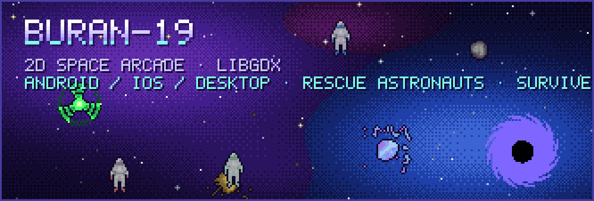
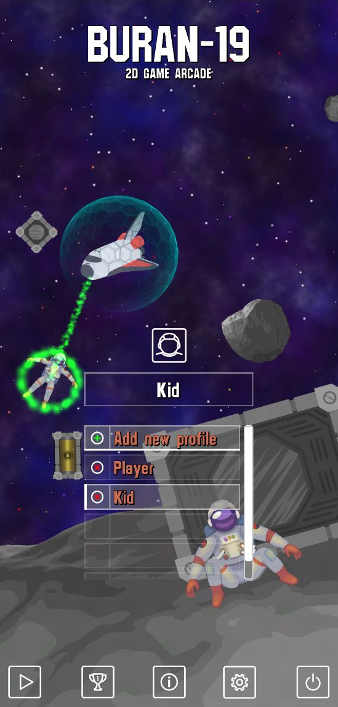
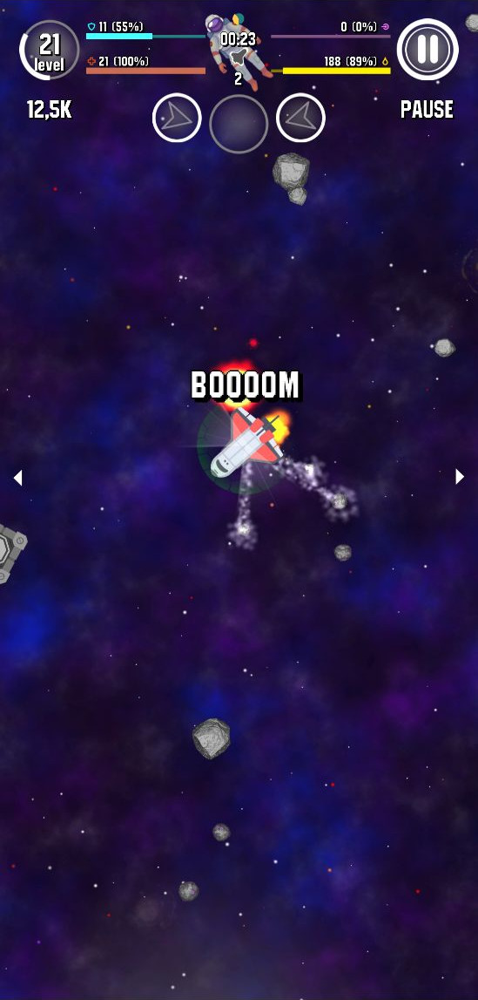
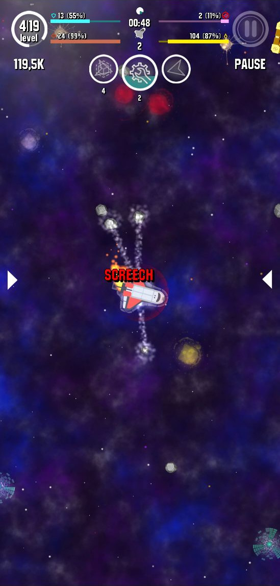
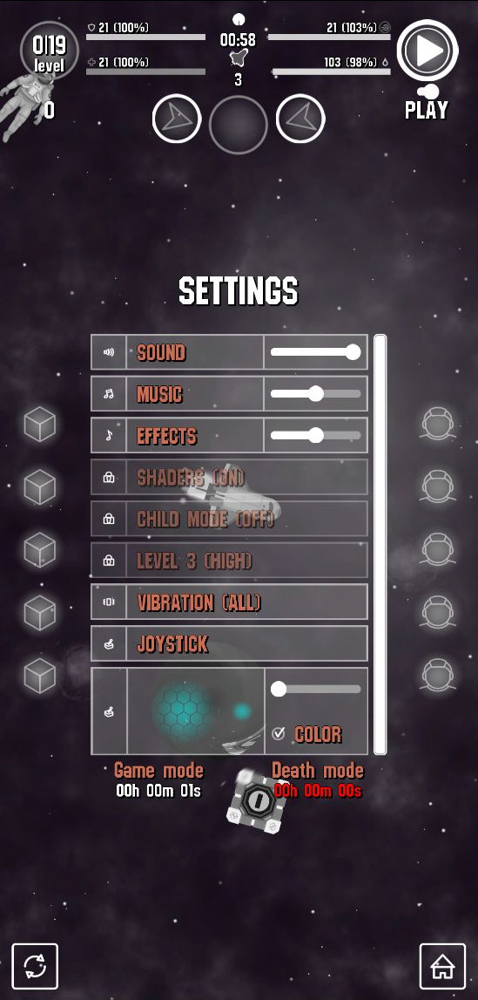
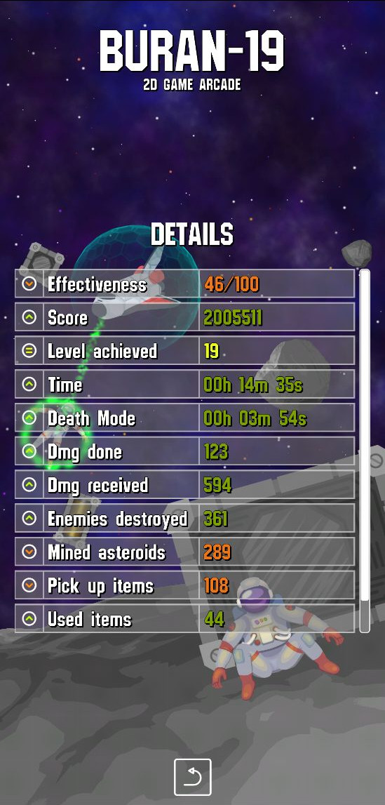
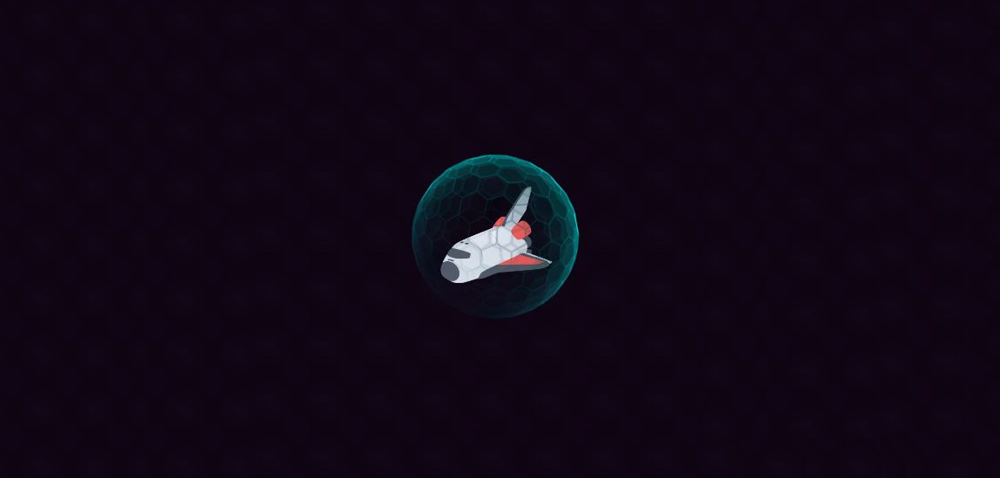

<p align="center">
  
</p>

<p align="center">
  
  
  
</p>

Buran-19 is an indie 2D space arcade. You fly the Buran shuttle through open space, rescue stranded astronauts
and stay alive as long as the fuel lasts.


## Gameplay

Fly close to a stranded astronaut and the tractor beam pulls them aboard. Medics, mechanics, scientists and military crew
each bring their own bonus. Crates, fuel boxes and storages refill fuel, shields and weapons.

Space is full of things that want you dead: metal and mineral asteroids, black holes and four kinds of anomalies
(corrosive, electrical, magnetic, radiation). The laser burns asteroids, and a burned asteroid splits into fragments.
Rockets launch from the shuttle and home in on anomalies. You also have shields, freeze, scan and radar,
and chain kills count as killing sprees.

The game keeps several player profiles, has difficulty levels and stores a detailed score history.

## Screenshots

<p align="center">
  
  
  
  
</p>
<p align="center">
  
  
  
  
</p>

## Play on Xbox

The game runs in the browser, so on Xbox it is played in Microsoft Edge. No Dev Mode needed.

1. Open the game URL in Edge on the console (GitHub Pages: `https://soloyes.github.io/OpenShuttle/`).
2. Press **A** on the start screen. This switches to fullscreen and unlocks sound.
3. Play with the controller:

| Control | In flight | In menus, pause, game over |
|---|---|---|
| Left stick | Steer the shuttle (deflection = thrust) | Move the cursor |
| A | Use the selected item | Click under the cursor (hold to drag sliders/lists) |
| X / RT | Use the selected item | |
| LB / RB, D-pad | Previous / next item | D-pad moves the cursor |
| Menu (Start) / View | Pause | Resume |
| B | | Resume from pause |
| Right stick | | Scroll lists |

On a PC the same build works with a mouse, or with the keyboard: arrows/WASD to fly, Space to use an item, Q/E to switch items, Esc to pause.

## Build and run

Requires JDK 17 or newer. The Gradle wrapper (Gradle 9) downloads everything else.

```bash
./gradlew desktop:run                       # desktop (LWJGL3)
./gradlew web:gdx_teavm_web_js_run          # web dev build, http://localhost:8080
./gradlew web:gdx_teavm_web_js_release_run  # optimized web build, http://localhost:8180
./gradlew web:gdx_teavm_web_js_release_build  # output: web/build/dist/js/release/webapp
./gradlew desktop:generateFonts             # re-bake assets/fonts/*.fnt from the TTF
```

Every push to `main` builds the web version and deploys it to GitHub Pages (`.github/workflows/web.yml`).
Pages must be enabled once in the repository settings: Settings, Pages, Source: GitHub Actions.

## How the web port works

- Java is compiled to JavaScript with [gdx-teavm](https://github.com/xpenatan/gdx-teavm) (TeaVM).
- Fonts are pre-rendered bitmap fonts instead of FreeType at runtime (`desktop/fontgen`).
- Profiles and settings are stored with libGDX `Preferences`: `localStorage` in the browser, `~/.prefs/buran19` on desktop.
- Gamepad support is in `core/src/com/buran/game/input/Gamepad.java` (gdx-controllers, browser Gamepad API).
- `web/webapp/index.html` is the entry page: Xbox start screen, fullscreen, audio unlock, and it keeps the B button
  (browser Back on Xbox) from leaving the game.
- Ads and Google Play links are switched off.

## Project layout

| Module | Contents |
|---|---|
| `core` | All game logic: shuttle, bots (asteroids, rockets, anomalies, black hole, consumables), effects, UI, screens, gamepad input |
| `assets` | Sprites, sounds, music, shaders, pre-rendered fonts |
| `web` | TeaVM web launcher and the Xbox-friendly entry page |
| `desktop` | LWJGL3 desktop launcher and the font baking tool |
| `tools` | Texture packer and skin composer projects, source images, store graphics |

The original Android and iOS launchers were removed in the web port; they are in the git history.
The previous contents of this repository are kept under the tag `legacy/openshuttle`.

## Authors

Made by [Vitaly Solovev](https://github.com/soloyes), with contributions from FlameXander, Pavel Guryanov and htfdream.

History moved from [Bitbucket](https://bitbucket.org/soloyes/buran-19) with all 595 commits and branches.
